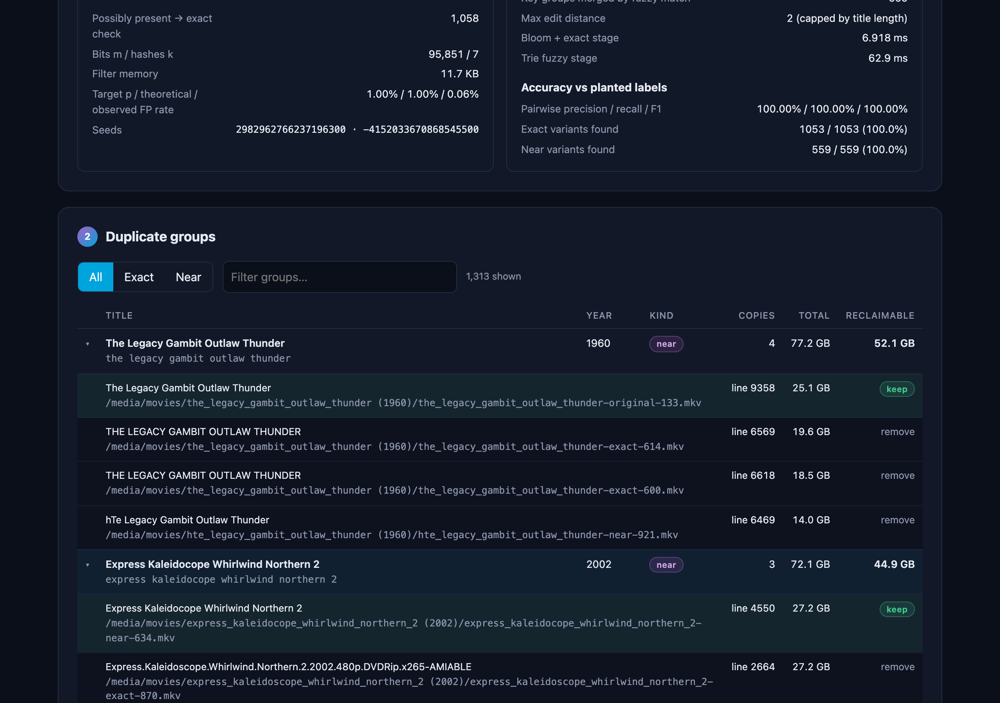
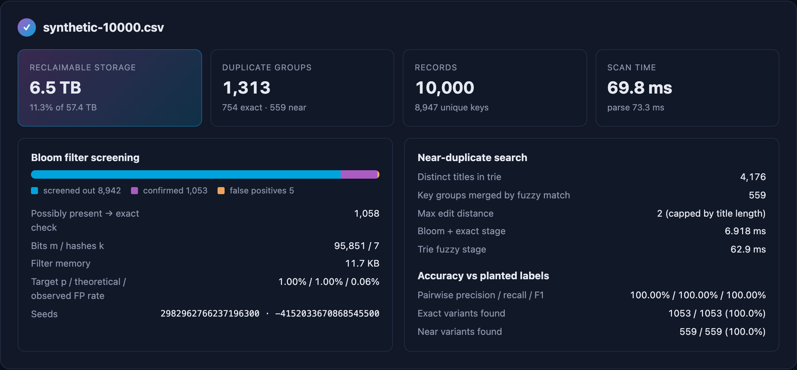
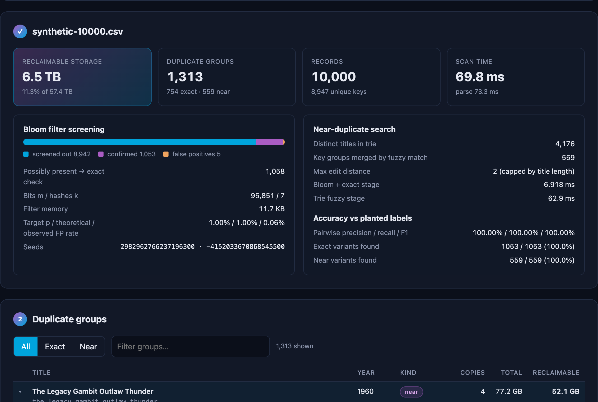
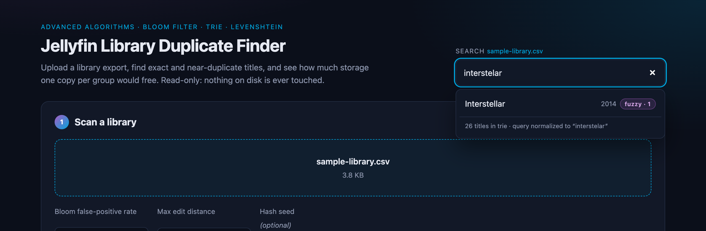
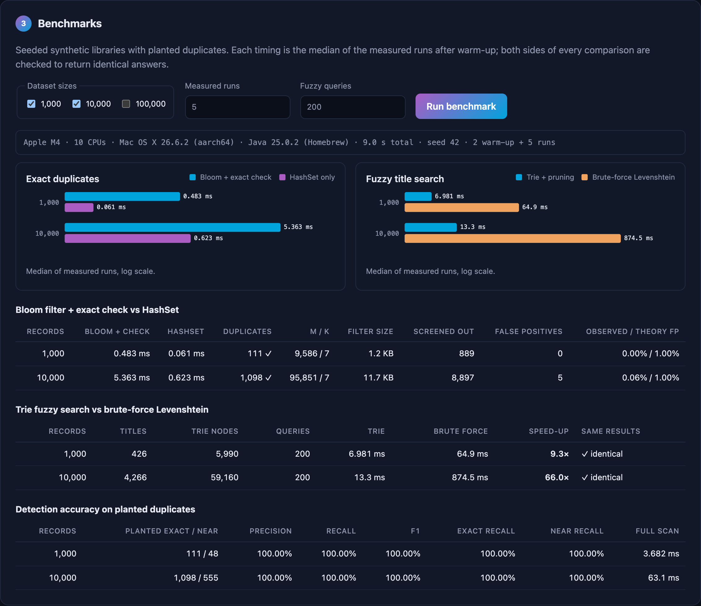

# Jellyfin Library Duplicate Finder

An Advanced Algorithms project. Upload a Jellyfin library export as CSV and the app finds exact and near-duplicate titles, groups them, and shows how much storage you would get back by keeping one copy per group. It only reads the CSV and never deletes anything.

Every assessed algorithm is a class written for this project. Spring Boot, Jackson and React handle only HTTP, JSON and UI. The project uses no Guava, no library Bloom filter, no library trie and no library edit distance.

| Algorithm | Class |
|---|---|
| Title normalizer | `backend/src/main/java/com/jellydupes/algo/Normalizer.java` |
| Two seeded hash functions (FNV-1a variant, Murmur-style block mix) | `algo/SeededHash.java` |
| Bloom filter (sizing formulas, double hashing) | `algo/BloomFilter.java` |
| Bloom-first exact duplicate screening | `algo/DuplicateScreener.java` |
| Trie (prefix search, fuzzy search with a Levenshtein row per node) | `algo/Trie.java` |
| Levenshtein distance and the brute-force baseline | `algo/Levenshtein.java`, `algo/BruteForceMatcher.java` |
| Union-find, used to merge near-duplicate groups | `algo/DisjointSet.java` |

Packages: `algo` (algorithms), `service` (CSV parsing, scan pipeline, search, accuracy), `api` (REST controllers and error handling), `bench` (seeded generator and benchmark harness).

---

## Prerequisites

- **JDK 17 or newer.** The code compiles with `--release 17`. It was developed and tested on JDK 25.
- **Maven 3.9 or newer**
- **Node.js 20.19 or newer** (or 22.12+) and npm, for Vite 7. Tested with Node 24.

## Build and run

### Backend (port 8080)

```bash
cd backend
mvn spring-boot:run                  # start the API on http://localhost:8080
mvn test                             # 53 JUnit 5 tests
mvn package && java -jar target/jellyfin-duplicate-finder-1.0.0.jar
```

If port 8080 is already in use: `mvn spring-boot:run -Dspring-boot.run.arguments=--server.port=8081`

### Frontend (port 5173)

```bash
cd frontend
npm install
npm run dev                          # http://localhost:5173, /api is proxied to :8080
# backend on another port:
BACKEND_URL=http://localhost:8081 npm run dev
npm run build                        # production bundle in dist/
```

### Benchmarks and datasets (CLI)

```bash
cd backend
mvn -q compile exec:java -Dexec.args="1000 10000 100000"     # writes benchmark-results.md
mvn -q compile exec:java -Dexec.mainClass=com.jellydupes.bench.GenerateDatasetsMain -Dexec.args="../samples"
```

---

## How it works

### 1. Normalizer
1. Strip accents and lowercase the title.
2. Take a year in brackets, such as `(1999)`, out of the title and keep it as the year.
3. Remove bracketed tags (`[YTS.MX]`, `{RARBG}`) and edition labels (`Extended Edition`, `Director's Cut`).
4. Change `&` to `and`. Delete apostrophes and turn all other punctuation into spaces.
5. Scene-style names: everything from the first quality tag onward is cut. Quality tags include `1080p`, `BluRay`, `x264`, `WEB-DL`, `HEVC`, audio codecs and `S01E02`. The cut also removes a trailing `-GROUP` release group. If the token just before the cut is a year, it becomes the year.

A number at the end of a title only counts as a year if it equals the CSV year or the title is in scene format. That is why `Blade Runner 2049` keeps its 2049.

The exact-duplicate key is `type | normalized title | year`, plus `|s{season}e{episode}` for episodes.

### 2. Bloom filter
- Bit array size `m = ceil(-(n ln p) / (ln 2)^2)`, packed into a `long[]`. Number of hashes `k = round((m / n) ln 2)`, with a minimum of 1.
- Double hashing: `h_i = h1 + i*h2 (mod m)`. `h1` and `h2` come from two hand-written 64-bit hashes with independent seeds. `h2` is forced odd so the probe sequence doesn't collapse.
- Each scan gets new random seeds unless you pass `seed` for a reproducible run.
- Validation: `n` must be at least 1, and `p` must satisfy `0 < p < 1` and not be NaN. Anything else throws `IllegalArgumentException`.

### 3. Scan pipeline (`DuplicateScreener`, `DuplicateDetector`)
For each record key:
- **Bloom says "definitely not present":** the record is unique so far. It is stored in the HashMap without a lookup and counted as `screenedOut`.
- **Bloom says "possibly present":** check the HashMap. A hit is a **confirmed duplicate**. A miss is a **false positive**, and the record is stored as new.

The counters always satisfy `screenedOut + possiblyPresent = records` and `possiblyPresent = confirmed + falsePositives`.

### 4. Trie and near duplicates
- Every distinct normalized title is inserted into a `Trie`, together with references to its records. Inserting the same title again adds another reference.
- **Prefix search:** walk down to the node for the prefix, then do a depth-first search of its subtree in alphabetical order. This powers autocomplete.
- **Fuzzy search:** a depth-first search over the trie. Each node gets one Levenshtein DP row, computed in O(|q|) from its parent's row. If the smallest value in a row is larger than the maximum distance, no word below that node can match, so the whole branch is skipped.
- Each distinct title is fuzzy-searched in parallel. Two matching titles are merged with union-find only if all of these hold:
  - same type, and the same season and episode;
  - the same year, or one of the years is missing;
  - the same digits (a guard against sequels: `toy story 2` vs `toy story 3`);
  - the distance is within a limit that depends on title length: `min(maxDistance, (len-1)/4)`. Titles under 5 characters must match exactly, titles under 9 characters allow 1 edit, and longer titles allow 2. This keeps `up`/`us` and `parasite`/`paradise` apart.
- For each group, the largest file is kept. Reclaimable storage is the group's total size minus the kept file.

### 5. Seeded data generator (`bench/LibraryGenerator`)
The generator makes synthetic libraries of any size with a fixed seed. 20% of entries are TV episodes.
- Each base title gets a `dup_group` label.
- **Exact variants** are the same title written differently: scene names with quality tags and release groups, bracketed tags, uppercase, or extra punctuation. These are labeled `dup_kind=exact`.
- **Near variants** are 1–2 letter typos (substitution, deletion, insertion or adjacent swap). Each one is checked to be 1–2 edits away after normalization. These are labeled `dup_kind=near`.

When an uploaded CSV has these label columns, `/api/scan` also reports pairwise precision and recall.

---

## Benchmark results

These come from the CLI run in [`docs/benchmark-results.md`](docs/benchmark-results.md):
- Machine: Apple M4 (10 logical CPUs), macOS 26.6.2 (aarch64), max heap 4 GB
- Java 25.0.2 (Homebrew OpenJDK)
- Seed 42, p = 0.01, maximum edit distance 2, 200 fuzzy queries
- 2 warm-up runs, then the **median of 5** measured runs

Each table compares the two methods on the same data, and the harness checks that both return identical results.

**Exact duplicates: Bloom filter + exact check vs HashSet only**

| records | Bloom + check | HashSet | duplicates found (both) | m / k | filter size | false positives |
|---:|---:|---:|---:|---:|---:|---:|
| 1,000 | 0.60 ms | 0.05 ms | 111 | 9,586 / 7 | 1.2 KB | 0 |
| 10,000 | 2.89 ms | 0.57 ms | 1,098 | 95,851 / 7 | 11.7 KB | 5 |
| 100,000 | 30.9 ms | 3.8 ms | 10,574 | 958,506 / 7 | 117 KB | 79 |

**Fuzzy search: trie with pruning vs brute-force Levenshtein**

| records | distinct titles | trie | brute force | speed-up |
|---:|---:|---:|---:|---:|
| 1,000 | 426 | 6.1 ms | 63.8 ms | 10× |
| 10,000 | 4,266 | 11.6 ms | 859 ms | 74× |
| 100,000 | 41,916 | 36.5 ms | 9,516 ms | 261× |

**Detection accuracy on the planted duplicates (pairwise)**

| records | precision | recall | exact recall | near recall | full scan |
|---:|---:|---:|---:|---:|---:|
| 1,000 | 1.0000 | 1.0000 | 1.0000 | 1.0000 | 9 ms |
| 10,000 | 1.0000 | 1.0000 | 1.0000 | 1.0000 | 60 ms |
| 100,000 | 0.9995 | 1.0000 | 1.0000 | 1.0000 | 1.4 s |

### Reading these honestly
- **The HashSet baseline is about 8× faster than Bloom + check here.** The pipeline still keeps every record in a HashMap, so the Bloom filter is extra work on top of it. The Bloom filter would pay off where the exact store is expensive to query, such as a database or disk index. In that setting it saves that lookup for about 89% of records while using only about 1.2 bytes per key. The benchmark reports this cost rather than hiding it.
- **The observed false-positive rate (about 0.09%) is lower than p = 1%.** The pipeline queries the filter while it is still filling up, so on average it is about half full. The rate at full capacity is checked separately in `BloomFilterTest.measuredFppNearTheory`: on 100k keys it lands within ±25% of the theoretical value.
- **The 100% recall applies only to this generator's definition of "near duplicate".** Every planted typo is within the detector's length-scaled distance. Real-world variants outside that range, such as alternate titles, translations, roman numerals versus digits, or long subtitles, would be missed.
- **Precision falls below 100% at 100k** because different random base titles sometimes end up within 2 edits of each other with the same year. These are real false merges and are counted as such.

---

## REST API

| Method | Path | Description |
|---|---|---|
| `POST` | `/api/scan` | Multipart field `file` (CSV). Optional params: `fpRate` (0–1, exclusive; default 0.01), `maxDistance` (0–5, default 2), `seed`. |
| `GET` | `/api/search?q=&limit=10&maxDistance=2` | Autocomplete over the last scanned library (the bundled sample until something is scanned). Returns prefix matches first, then fuzzy matches. |
| `POST` | `/api/benchmark` | JSON body. All fields optional: `sizes`, `fpRate`, `maxDistance`, `queries`, `warmupRuns`, `measuredRuns`, `seed`. |
| `GET` | `/api/sample` | The bundled 41-row sample CSV. |
| `GET` | `/api/sample/generated?size=1000&seed=42` | A seeded synthetic library with `dup_group` and `dup_kind` labels. |

```bash
curl -o sample.csv http://localhost:8080/api/sample
curl -F file=@sample.csv -F fpRate=0.01 -F maxDistance=2 http://localhost:8080/api/scan
curl "http://localhost:8080/api/search?q=interstelar"
curl -X POST -H 'Content-Type: application/json' \
     -d '{"sizes":[1000,10000],"measuredRuns":5,"seed":42}' http://localhost:8080/api/benchmark
```

Validation errors return HTTP 400 with a clear message and a list of details:

```json
{"status":400,"error":"The CSV has 2 invalid value(s).",
 "details":["Line 2: title is blank.","Line 2: year 'abc' is not a whole number."]}
```

The checks cover:
- empty files, and files with a header but no rows;
- missing columns (all missing names are listed);
- years that aren't numbers or fall outside 1870 to (current year + 2);
- blank titles, and titles made only of tags;
- bad size, runtime, season or episode values;
- `fpRate` or `maxDistance` out of range;
- requests that aren't multipart.

---

## Sample datasets (`samples/`)

| File | Contents |
|---|---|
| `sample-library.csv` | 41 hand-written rows. Exact duplicates come from scene names, `[YTS]` tags, case and accents. Near duplicates are typos (`The Matirx`, `Inceptoin`, `Braking Bad`). There are also look-alikes that must **not** merge: Blade Runner vs 2049, Toy Story 2 vs 3, Dune 1984 vs 2021, Up vs Us, Parasite vs Paradise. |
| `library-1000.csv`, `library-10000.csv` | Seeded synthetic libraries (seed 42 + size) with labels. |
| `library-100000.csv` | Rebuild it with `GenerateDatasetsMain`. It is about 16 MB and is git-ignored. |

The CSV format is `type,title,year,season,episode,path,size,runtime`, plus optional `dup_group,dup_kind` label columns. Columns can be in any order and header names are case-insensitive. `size` is in bytes and `runtime` is in minutes.

---

## Tests

`mvn test` runs **53 tests**.

**`BloomFilterTest`**
- no false negatives on 10k keys
- empty filter (boundary)
- the m and k formulas
- invalid p values: 0, 1, negative, greater than 1, NaN (boundary)
- invalid n, and very large p still gives k ≥ 1 (boundary)
- measured false-positive rate is close to theory on 100k keys
- duplicate inserts are idempotent
- 25 different seeds, none with false negatives
- a forced false positive is rejected by the exact check

**`TrieTest`**
- insert and lookup
- prefix search returns all matches and only matches
- empty string and single character (boundary)
- inserting the same title twice keeps both references
- fuzzy search at distances 0, 1 and 2
- fuzzy search equals brute force on 1,000 random titles
- titles are normalized before insert

**Other tests**
- `NormalizerTest`, `LevenshteinAndHashTest`
- `CsvLibraryParserTest`: validation
- `DuplicateDetectorTest`: expectations on the sample, sequel and short-title guards, precision and recall on generated data
- `ApiTest`: MockMvc tests of every endpoint and the 400 errors

---

## Screenshots

Scan results: summary, Bloom screening funnel, accuracy and expanded duplicate groups


Summary cards and Bloom statistics


Duplicate groups table (the kept copy is marked)


Autocomplete with a typo-tolerant fuzzy match


Benchmark tables and chart (log scale)

